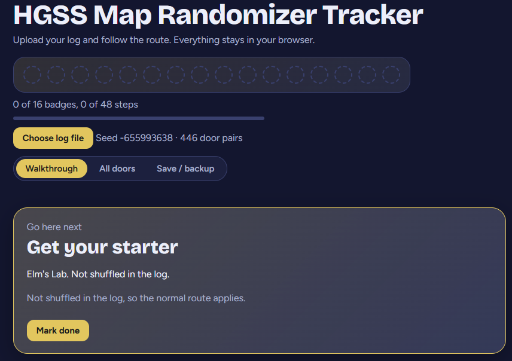

# HGSS Map Randomizer Tracker

A browser-based tracker for Pokémon HeartGold/SoulSilver map randomizer runs. Upload your randomizer log and get a story walkthrough that shows which door to take for each step, plus a searchable list of every door where you can record what you find.

**Live site:** https://YOUR-USERNAME.github.io/hgss-map-randomizer-tracker/

## Features

- Upload the `*_map_randomized.log` file. It is read in your browser and never sent anywhere.
- Story walkthrough in order: Johto badges, Elite Four, Kanto, postgame.
- For each step, the original door and where it now leads.
- Done checkboxes and a highlighted "next step".
- Searchable door list with Visited boxes and notes.
- Progress is saved in your browser per seed. Export and import it to move between devices.

## Works with

This tracker reads the log file produced by the [HGSS Map Randomizer](https://github.com/adrienntindall/hgss-map-randomizer/releases) by adrienntindall. Download the randomizer from its releases page; it is a separate project and is not included here.

**You need your own legally obtained HeartGold or SoulSilver ROM.** This project does not provide, link to, or help with finding ROMs.

The story walkthrough is built for HeartGold/SoulSilver only. That randomizer also supports other games, but those logs are not supported here.

## How to use

1. Run the HGSS Map Randomizer on your own ROM and keep the `.log` file it produces. The seed is on the first line of the log.
2. Open the site and click **Upload map log**.
3. Follow the Walkthrough tab. Use All doors to note where doors take you.

## How the log is read

Each line like `A <-> B` is treated as two connected doors: walking through A puts you at B, and the reverse. Each pair appears twice in the log, so duplicates are merged. Some doors (for example Elm's Lab) are not shuffled and do not appear in the log.

## Known limitations

- No automatic soft-lock or save-safety warnings yet. Back up your `.sav` or use emulator save states before key story events.
- No walking-route finder between doors yet. This needs a data file of the vanilla overworld connections.
- Story patterns are matched against entrance IDs and may need correcting. Pull requests welcome.

## Run locally

Open `index.html` in a browser. There is no build step.

## Contributing

Issues and pull requests are welcome, especially corrections to the story step patterns in `index.html` and, later, overworld connection data.

## Disclaimer

Unofficial fan project, not affiliated with or endorsed by Nintendo, Game Freak, The Pokémon Company, or the author of the HGSS Map Randomizer. It contains no game data or ROMs, and users must supply their own.

## License

MIT
